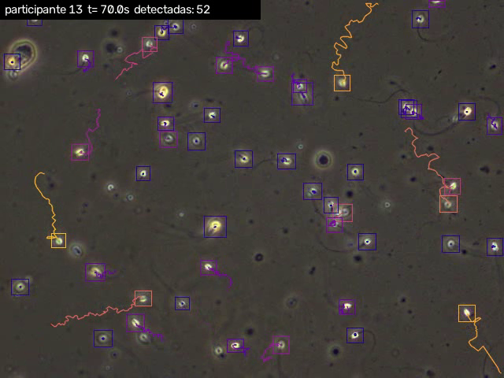
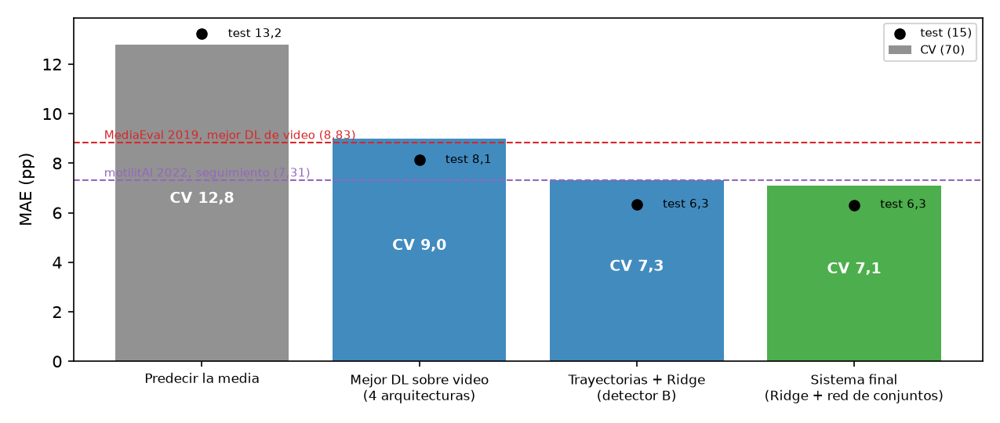
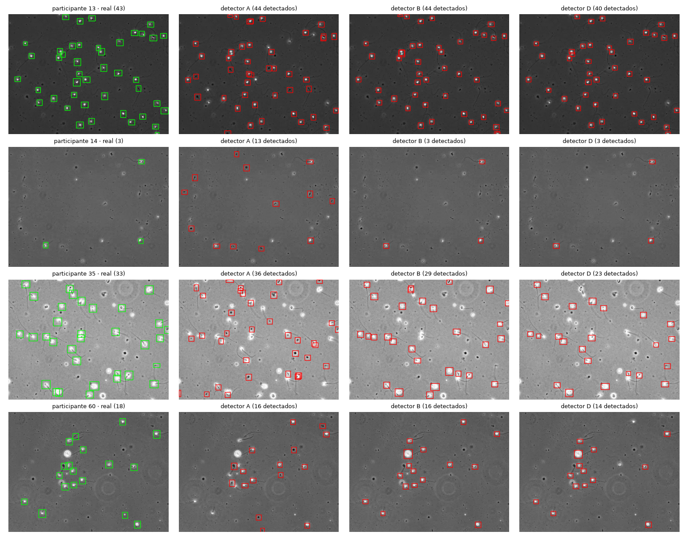
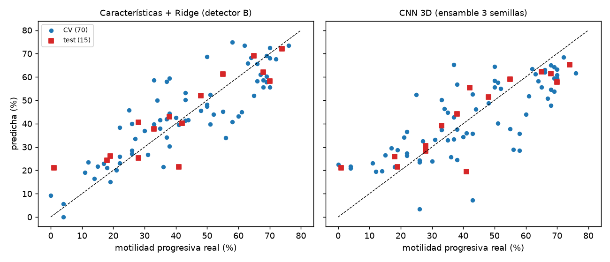
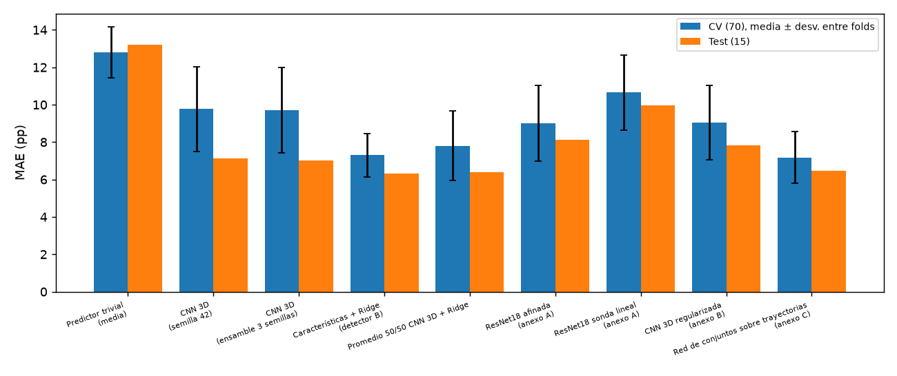

# Estimación de la motilidad espermática en videos microscópicos (VISEM)


**Proyecto final de Deep Learning — Universidad EAFIT (noviembre de 2026)**  
Autores: **Felipe Giraldo** y **Santiago Villamizar**

---

<p align="center">
  
  <br>
  <em>Detección (YOLO11n afinado) y seguimiento de trayectorias (ByteTrack) sobre un cuadro real del dataset VISEM (participante 13).</em>
</p>

## Resumen del sistema

A partir de un video microscópico de muestra seminal, el sistema estima los porcentajes de motilidad **progresiva**, **no progresiva** e **inmóvil**.

1. **Detección y seguimiento:** un detector **YOLO11n** (preentrenado con EVISAN y afinado con VISEM-Tracking, *detector B*) junto con **ByteTrack** reconstruyen la trayectoria de cada espermatozoide.
2. **Descriptores y predicción:** a partir de las trayectorias se extraen **24 descriptores de movimiento** (velocidad, linealidad, desplazamiento y proporción de células casi quietas) que alimentan un modelo **Ridge** y una **red de conjuntos (Deep Sets)**; el promedio de ambos constituye el sistema final.
3. **Desempeño:** alcanza un **MAE de 7,11 puntos porcentuales (pp)** en validación cruzada agrupada por participante ($n = 70$) y **6,32 pp** en el conjunto de prueba fijo ($n = 15$), frente a **12,80 pp** y **13,22 pp** de predecir el promedio.

> **Alcance clínico:** este sistema es una herramienta de apoyo al análisis de calidad seminal; **no** diagnostica fertilidad.

---

## Resultados visuales

### Comparación general de enfoques

<p align="center">
  
  <br>
  <em>Error absoluto medio (MAE) en validación cruzada (70 participantes) y test (15 participantes), comparado con referencias de la literatura sobre VISEM.</em>
</p>

| Enfoque | MAE CV (70) | MAE Test (15) |
| --- | :---: | :---: |
| Predictor trivial (media) | 12,80 pp | 13,22 pp |
| Mejor DL directo sobre video (4 arquitecturas) | 9,00 pp | 8,13 pp |
| Trayectorias (detector B) + Ridge | 7,31 pp | 6,33 pp |
| Trayectorias (detector B) + Red de conjuntos (Deep Sets) | 7,18 pp | 6,45 pp |
| **Sistema final (promedio Ridge + Red de conjuntos)** | **7,11 pp** | **6,32 pp** |

### Transferencia de detección (EVISAN → VISEM)

La transferencia directa desde EVISAN (*detector A*) confunde residuos celulares con espermatozoides en VISEM (mAP@0.5 de **0,264** en VISEM-test frente a **0,886** en EVISAN-test). Afinar sobre VISEM-Tracking (*detector B*) corrige gran parte de los falsos positivos y alcanza **0,470** de mAP@0.5 en VISEM-test.

<p align="center">
  
  <br>
  <em>Anotaciones reales (verde) y detecciones (rojo) de los detectores A, B y D en los 4 participantes de prueba con etiquetas de seguimiento.</em>
</p>

### Ajuste de predicciones y comparación de arquitecturas

<p align="center">
  
  <br>
  <em>Motilidad progresiva predicha frente a valores de laboratorio: características de trayectoria + Ridge (izquierda) vs. CNN 3D sobre video (derecha).</em>
</p>

<p align="center">
  
  <br>
  <em>Comparación de MAE (media ± desviación entre folds en CV y resultado en test) para todas las variantes evaluadas.</em>
</p>

---

## Contenido del repositorio

| Ruta | Descripción |
| --- | --- |
| [`reports/informe_final.pdf`](reports/informe_final.pdf) | Informe final (3 páginas) |
| [`reports/documento_tecnico.pdf`](reports/documento_tecnico.pdf) | Documento técnico complementario (11 páginas): análisis completo de métodos, entrenamiento, resultados, errores y experimentos adicionales |
| [`reports/presentacion.pdf`](reports/presentacion.pdf) | Presentación en PDF (21 diapositivas). [`reports/presentacion.html`](reports/presentacion.html) es la versión interactiva para proyectar (`N`: notas del orador, `F`: pantalla completa) |
| [`estimacion_motilidad_visem.ipynb`](estimacion_motilidad_visem.ipynb) | Cuaderno principal ejecutado: secciones 1 a 7 (problema, datos, arquitectura, entrenamiento, resultados, conclusiones y referencias) y anexos A a F |
| `src/` | Scripts modulares para particiones, extracción, entrenamiento, seguimiento, descriptores, regresión y figuras |
| [`data/splits/folds.csv`](data/splits/folds.csv) | Partición fija por participante (test de 15 + 5 folds sobre 70), semilla 42 |
| `reports/*.csv` | Predicciones y métricas guardadas que consume el cuaderno |
| `reports/figures/` | Figuras generadas para el informe, la presentación y este README |
| [`requirements.txt`](requirements.txt) | Versiones exactas del entorno |

## Qué no se incluye y por qué

- **Datos originales.** VISEM (más de 35 GB, licencia solo para investigación y educación), VISEM-Tracking y EVISAN se descargan de sus fuentes oficiales:
  - VISEM: Haugen et al. (2019), MMSys'19, https://dl.acm.org/doi/10.1145/3304109.3325814
  - VISEM-Tracking: Thambawita et al. (2023), https://zenodo.org/record/7293726 (CC BY 4.0)
  - EVISAN: Yan (2020), https://doi.org/10.5281/zenodo.4303768 (CC BY 4.0)
- **Datos procesados, trayectorias, pesos de modelos y videos de demostración** (`data/processed/`, `models/`, `reports/demo/`): pesan varios GB y se regeneran con los scripts de `src/`.

## Entorno

Equipo local con CPU Intel Core Ultra 9 275HX, 31,4 GB de RAM y GPU NVIDIA RTX 5070 Ti Laptop (12 GB); Windows 11, Python 3.13.14, PyTorch 2.11 con CUDA 12.8 (necesario para la arquitectura Blackwell).

```bash
python -m venv .venv
.venv\Scripts\activate          # en Linux o macOS: source .venv/bin/activate
pip install -r requirements.txt  # incluye el índice de PyTorch para CUDA 12.8
```

Los datos originales van en la raíz del proyecto: `visem-dataset/`, `VISEM-Tracking/extracted/` y `EVISAN/`.

## Cómo reproducir, en orden

| Paso | Comando | Produce |
| --- | --- | --- |
| 1. Partición por participante | `python src/make_splits.py` | `data/splits/folds.csv` (ya incluido; no regenerar) |
| 2. Extraer clips una sola vez | `python src/extract_videos.py` | `data/processed/visem_gray/` |
| 3. Datos del detector | `python src/prepare_detector_data.py` | `data/processed/evisan_yolo/`, `visem_yolo/` |
| 4. Entrenar detectores | `python src/train_detector.py A_evisan_only B_evisan_to_visem C_visem_only D_evisan_to_visem_960` | `models/detector/` |
| 5. Evaluar detección | `python src/eval_detector.py` | `reports/detector_eval.csv` |
| 6. Seguimiento de los 85 videos | `TRACK_CONF=0.4 python src/track_videos.py B_evisan_to_visem` | `data/processed/tracks/` |
| 7. Calidad del seguimiento | `python src/eval_tracking.py B_evisan_to_visem val 0.4` (y `test`) | `reports/tracking_eval_*.csv` |
| 8. Descriptores y Ridge | `python src/motion_features.py B_evisan_to_visem` y `python src/motility_regression.py B_evisan_to_visem` | `reports/regression_*.csv` |
| 9. Red de conjuntos (3 semillas) | `python src/track_set_net.py B_evisan_to_visem 42` (y 7, 123) | `reports/baseline_predictions_trackset_s*.csv` |
| 10. Línea base de video | `python src/baseline_video.py` (semillas con `BASE_SEED=7` y `123`) y `python src/exp_variants.py <resnet\|resnet_probe\|reg3d\|r3d> <semilla>` | `reports/baseline_predictions*.csv` |
| 11. Experimentos de los anexos | `rule_baseline.py`, `bow_svr.py`, `extra_features.py`, `track_set_nested.py` | `reports/*.csv` |
| 12. Sistema final y uso | `python src/final_system.py` y `python src/predict_video.py <video.avi>` | `models/final/`; estimación con intervalo al 90 % y aviso |
| 13. Figuras de demostración | `demo_figures.py`, `demo_video.py`, `case_figures.py` | `reports/figures/`, `reports/demo/` |

`src/results_utils.py` contiene las funciones comunes de evaluación (MAE, RMSE, carga de predicciones) que usa el cuaderno.

## Reglas metodológicas

- Partición estricta por participante, nunca por frame o clip (los frames consecutivos son casi idénticos); EVISAN se divide por secuencia.
- El test de 15 participantes se evalúa una sola vez; todas las decisiones se toman con la validación cruzada.
- En las redes se usa siempre la última época, con 3 semillas (`42`, `7` y `123`).
- Las comparaciones entre modelos son pareadas sobre los 85 participantes fuera de muestra, con intervalos de confianza por bootstrap.
